# ATU CloudFormation Assignment: L00205332

[](https://github.com/L00205332/workrepo/actions/workflows/cfn-validate.yml)

**Module:** IaC for DevOps Pipelines, Atlantic Technological University
**Student:** Mohamed Hanafi Sayed Khalifa Ismail (L00205332)
**Lecturer:** Ruth Lennon

This README is the lab write-up for the assignment.

> [!IMPORTANT]
> **Always destroy the stacks when you finish.** This project runs on a free-tier AWS account
> with limited credits. Every deploy session ends with the clean-up steps in
> [section 10](#10-clean-up), followed by a check that nothing is left running. The three-tier
> stack costs about $3-4 per day while it exists, even when idle.

---

## 1. Declared tutorials and LLM usage

> **Declaration (assignment brief, Part A Q2):** an LLM was used for this assignment. Every
> prompt is declared, word for word, in **[PROMPTS.md](PROMPTS.md)**, together with a summary
> of the response and what I did with it ("My action").

| Item | Declaration |
|------|-------------|
| LLM used | **Claude Code** (model Claude Opus 5.5), in the Claude desktop app |
| Prompts | 24 logged entries (P1 to P24) in [PROMPTS.md](PROMPTS.md). Troubleshooting exchanges and evidence sharing are not logged. |
| Tutorials | None followed. The only external tutorial-style source is the AWS Lambda IaC page quoted in the brief (entry T1 in [PROMPTS.md](PROMPTS.md)). |
| Third-party templates | None |

**How the LLM was used:**

- To generate the **baseline** templates (the single-file static site and the three-tier stack).
- To explain concepts and options when I asked: Part A(a) vs A(b), packaging and nested
  stacks, branching strategy, CI policy.
- To implement the changes **I chose**, and to review evidence and diagnose test findings.

**What I did myself:**

- I made every design decision:
  - the modular nested-stack layout and the separate `loadbalancer` module;
  - Multi-AZ RDS over Aurora;
  - the four "next level" improvements;
  - an advisory cfn-nag;
  - always deploying from `main`;
  - destroying every stack after each session.
- I reviewed the code before every deployment.
- I ran **every** git commit, push and pull request (section 9) and **every** AWS deployment,
  test and clean-up command myself. The LLM never committed code.
- I took the console and browser screenshots used as evidence.

## 2. Overview

In this project I have delivered the following parts:

- **Part A(a):** a static website hosted from S3 and served publicly, with my L-number and name as the header.
- **Part A(b):** a three-tier architecture (web, application, database tiers).
- **Part A, Q2 ("next level"):** a second round of enhancing the three-tier architecture.
  I made the RDS database Multi-AZ (after considering Aurora), separated the application
  code from the instance deployment, extended monitoring with CloudWatch alarms and SNS
  notifications, and added a CI pipeline with cfn-lint and cfn-nag. See [section 8](#8-taking-it-to-the-next-level).
- **Part B:** best practices, tooling and the "ilities" (security, scalability, performance, cost).
  See [section 7](#7-part-b-best-practices-and-ilities).

## 3. Repository structure

```
.
├── static-site/                # Part A(a): S3 + CloudFront static website
│   ├── main.yaml               # root stack, wires the modules together
│   ├── modules/
│   │   ├── storage.yaml        # private, encrypted S3 bucket
│   │   ├── cdn.yaml            # CloudFront + OAC + bucket policy
│   │   └── content.yaml        # Lambda custom resource that publishes the pages
│   └── parameters/dev.json     # parameter values for the dev environment
├── three-tier/                 # Part A(b): web, application and database tiers
│   ├── main.yaml               # root stack, wires the modules together
│   ├── modules/
│   │   ├── networking.yaml     # VPC, subnets, route tables, security groups, VPC endpoints
│   │   ├── loadbalancer.yaml   # web tier: Application Load Balancer
│   │   ├── compute.yaml        # application tier: EC2 Auto Scaling group + app
│   │   ├── database.yaml       # database tier: RDS PostgreSQL (Multi-AZ)
│   │   └── monitoring.yaml     # CloudWatch alarms + RDS events -> SNS email
│   ├── app/
│   │   ├── app.py              # application tier source: Python UI + JSON API
│   │   └── app.service         # hardened systemd unit that runs the app
│   └── parameters/dev.json
├── .github/workflows/
│   └── cfn-validate.yml        # CI: cfn-lint, ruff (app) and cfn-nag on every pull request
├── .cfnlintrc.yaml             # cfn-lint configuration (lints every template)
├── PROMPTS.md            # Declared tutorials and LLM prompts
└── README.md             # This write-up
```

## 4. Prerequisites

- An AWS account with a non-root IAM identity (root user MFA enabled, budget alarm configured)
- AWS CLI v2 with a named profile
- [cfn-lint](https://github.com/aws-cloudformation/cfn-lint)

### 4.1 How the projects are deployed (nested stacks)

Each project is a **root stack** (`main.yaml`) that composes **modules**. Each module is a
nested stack (`AWS::CloudFormation::Stack`), the CloudFormation equivalent of a Terraform
module. One module's outputs are passed as another module's parameters, and those links set
the creation and deletion order.

Nested stack templates must be in S3, so deployment has two steps:

1. `aws cloudformation package` uploads each module to an artifacts bucket and writes a
   `packaged-main.yaml` whose `TemplateURL`s point at S3. The file is git-ignored.
2. `aws cloudformation deploy` creates or updates the root stack from the packaged file, with
   the values in `parameters/<env>.json`.

Create the artifacts bucket once. It must have a globally unique name:

```bash
aws s3 mb s3://l00205332-cfn-artifacts-eu-west-1 --profile atu --region eu-west-1
```

> Commands are shown in bash style. In PowerShell, replace the trailing `\` line
> continuations with a backtick (`` ` ``), or put each command on one line.

## 5. Part A(a): Static website on S3

### 5.1 Architecture

```
Visitor --HTTPS--> CloudFront distribution  (cdn module)
                     | HTTP -> HTTPS redirect, HTTP/2+3, gzip/brotli,
                     | managed security headers, custom 404 page
                     |
                     | requests signed with Origin Access Control (SigV4)
                     v
                   Private S3 bucket  (storage module)
                     encrypted (SSE-S3), versioned, all public access blocked,
                     bucket policy: read only by this distribution, TLS only
                     ^
                     | writes index.html, error.html, styles.css on create/update
                     | empties the bucket on delete
                   Lambda custom resource  (content module)
```

The root stack [`static-site/main.yaml`](static-site/main.yaml) creates three nested stacks:

| Module | Purpose | Key resources |
|--------|---------|---------------|
| [`storage.yaml`](static-site/modules/storage.yaml) | Stores the web pages | `AWS::S3::Bucket` |
| [`cdn.yaml`](static-site/modules/cdn.yaml) | Public-facing web service over HTTPS | `AWS::CloudFront::Distribution`, `AWS::CloudFront::OriginAccessControl`, `AWS::S3::BucketPolicy` |
| [`content.yaml`](static-site/modules/content.yaml) | Publishes the page content at deploy time | `AWS::Lambda::Function`, `AWS::IAM::Role`, `AWS::Logs::LogGroup`, `Custom::WebsiteContent` |

The header shows `L00205332 – Mohamed Hanafi Sayed Khalifa Ismail`. Both values come from
[`static-site/parameters/dev.json`](static-site/parameters/dev.json), so the page content is
never hard-coded in the templates.

### 5.2 Deployment

Root stack: [`static-site/main.yaml`](static-site/main.yaml), modules in
[`static-site/modules/`](static-site/modules/)

```bash
# Lint first (uses .cfnlintrc.yaml)
cfn-lint

# 1. Upload the modules to S3 and write the packaged root template
aws cloudformation package \
  --profile atu --region eu-west-1 \
  --template-file static-site/main.yaml \
  --s3-bucket l00205332-cfn-artifacts-eu-west-1 \
  --s3-prefix static-site \
  --output-template-file static-site/packaged-main.yaml

# 2. Create or update the stack. CAPABILITY_IAM is needed because the content
#    module creates the IAM role for the deployer Lambda.
aws cloudformation deploy \
  --profile atu --region eu-west-1 \
  --stack-name l00205332-static-site-dev \
  --template-file static-site/packaged-main.yaml \
  --parameter-overrides file://static-site/parameters/dev.json \
  --capabilities CAPABILITY_IAM \
  --tags Project=atu-cloudformation Owner=L00205332 Environment=dev

# Print the website URL
aws cloudformation describe-stacks \
  --profile atu --region eu-west-1 \
  --stack-name l00205332-static-site-dev \
  --query "Stacks[0].Outputs[?OutputKey=='WebsiteURL'].OutputValue" --output text
```

The first deployment takes about 5 minutes, mostly while the CloudFront distribution is created.

### 5.3 Testing

Deployed on 2026-10-31 to `eu-west-1` from the `main` branch, as stack `l00205332-static-site-dev`.

#### Package and deploy

`cfn-lint` passed with no findings. The artifacts bucket was created once. `package` uploaded
the three modules to S3 and wrote `packaged-main.yaml`. `deploy` created the stack from that file
with the values in `parameters/dev.json`. Running `aws s3 mb` a second time returned
`BucketAlreadyOwnedByYou`, which confirms the bucket already existed and only needs creating once.

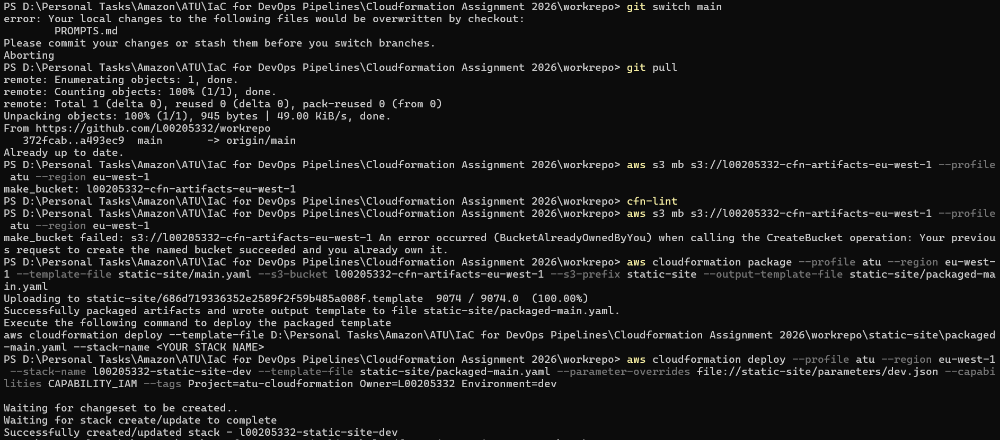

#### Nested stacks in the CloudFormation console

With **View nested** turned on, the console shows the root stack and its three module stacks,
all in `CREATE_COMPLETE`. The creation times show the order that the module dependencies
enforce: **storage** (12:06:41), then **cdn** (12:07:04), which needs the bucket, then
**content** (12:10:34), which needs both the bucket and the CloudFront distribution. Most of the
deploy time is spent creating the CloudFront distribution.

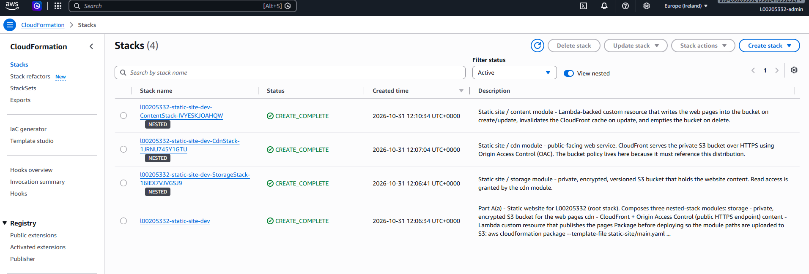

#### Stack outputs

The root stack exposes the website URL, the generated bucket name and the CloudFront
distribution ID. The bucket name is generated by CloudFormation, which avoids global naming
collisions.

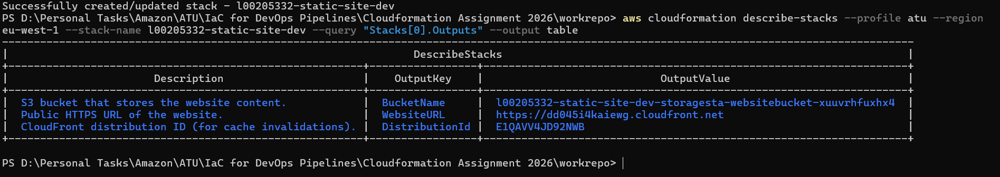

| Output | Value |
|--------|-------|
| WebsiteURL | `https://dd045i4kaiewg.cloudfront.net` |
| BucketName | `l00205332-static-site-dev-storagesta-websitebucket-xuuvrhfuxhx4` |
| DistributionId | `E1QAVV4JD92NWB` |

> These resources are destroyed after testing (see [section 10](#10-clean-up)), so the URL no
> longer works.

#### The live website

The site opened in a browser at the CloudFront URL (`https://dd045i4kaiewg.cloudfront.net`).
This shows that the whole path works:
- CloudFront served `index.html` as the default root object, over HTTPS.
- It fetched the page from the **private** S3 bucket using Origin Access Control.
- The page content was the one written by the Lambda content deployer.

The header shows **L00205332 – Mohamed Hanafi Sayed Khalifa Ismail**, as the assignment
requires. The deployment details (stack `l00205332-static-site-dev`, region `eu-west-1`,
environment `dev`) were filled in by CloudFormation at deploy time from the stack parameters
and pseudo-parameters, so they are not hard-coded in the HTML.

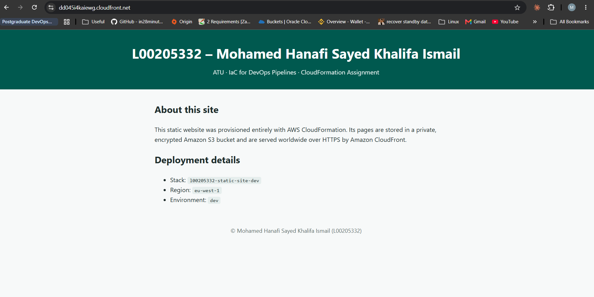

#### Functional and security checks

All four checks passed:

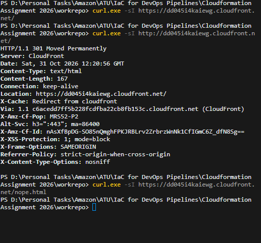

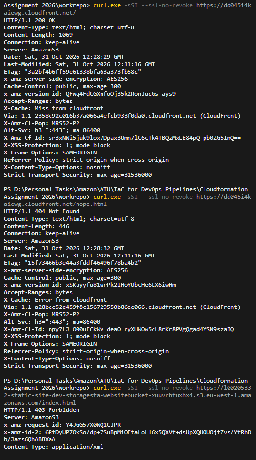

> **Note on Windows `curl.exe`:** the HTTPS checks first printed nothing, because `-s` hides
> errors. Windows curl (Schannel) could not complete the certificate revocation check from this
> network. Adding `-S` (show errors) and `--ssl-no-revoke` fixed it. This was a client-side
> issue; the site itself served HTTPS correctly, as the browser test confirms.

| # | Check | Command | Expected | Result |
|---|-------|---------|----------|--------|
| a | Site served over HTTPS with security headers | `curl.exe -sSI --ssl-no-revoke https://dd045i4kaiewg.cloudfront.net/` | `200`, with `strict-transport-security`, `x-frame-options`, `x-content-type-options` | ✅ `200 OK`, `Content-Type: text/html; charset=utf-8`, `Strict-Transport-Security: max-age=31536000`, `X-Frame-Options: SAMEORIGIN`, `X-Content-Type-Options: nosniff`, `x-amz-server-side-encryption: AES256` (object encrypted at rest), `Server: AmazonS3` behind `Via: ... (CloudFront)` |
| b | HTTP redirected to HTTPS | `curl.exe -sI http://dd045i4kaiewg.cloudfront.net/` | `301` to `https://` | ✅ `301 Moved Permanently`, `Location: https://dd045i4kaiewg.cloudfront.net/`, `X-Cache: Redirect from cloudfront`. The managed security headers (`X-Frame-Options`, `X-Content-Type-Options`, `X-XSS-Protection`, `Referrer-Policy`) are already present on the redirect. |
| c | Custom error page for missing pages | `curl.exe -sSI --ssl-no-revoke https://dd045i4kaiewg.cloudfront.net/nope.html` | `404` | ✅ `404 Not Found` with `Content-Length: 446` (the custom `error.html`, not S3's XML error) and `X-Cache: Error from cloudfront`. S3's `403` for the missing key was mapped to a `404` by the distribution's `CustomErrorResponses`. |
| d | Bucket not publicly readable | `curl.exe -sSI --ssl-no-revoke https://l00205332-static-site-dev-storagesta-websitebucket-xuuvrhfuxhx4.s3.eu-west-1.amazonaws.com/index.html` | `403` | ✅ `403 Forbidden` from S3. The object exists, but it can only be read through CloudFront (OAC), never directly. |

## 6. Part A(b): Three-tier architecture

### 6.1 Architecture

Root stack: [`three-tier/main.yaml`](three-tier/main.yaml), modules in
[`three-tier/modules/`](three-tier/modules/)

```
                    Internet
                       |  HTTP :80
          +------------v-------------+   VPC 10.0.0.0/16, 2 Availability Zones
WEB TIER  |  Application Load Balancer|   public subnets  10.0.0.0/24, 10.0.1.0/24
          +------------+-------------+
                       |  :8080 (ALB security group only)
          +------------v-------------+
APP TIER  |  EC2 Auto Scaling group   |   private subnets 10.0.2.0/24, 10.0.3.0/24
          |  Python UI + JSON API     |   no internet route; S3 + Secrets Manager endpoints
          +------------+-------------+
                       |  :5432 TLS (app security group only)
          +------------v-------------+
DB TIER   |  RDS PostgreSQL Multi-AZ  |   isolated subnets 10.0.4.0/24, 10.0.5.0/24
          |  primary (AZ a or b)      |   synchronous replication
          |  standby (other AZ)       |   automatic failover, same endpoint
          +--------------------------+
```

Every tier spans both Availability Zones: the ALB has a node in each public subnet, the Auto
Scaling group keeps one instance per AZ, and the database runs Multi-AZ. Losing a whole AZ does
not take the application down.

| Path | Tier | What it does |
|------|------|--------------|
| `/` | App, via the web tier | HTML page showing which instance and AZ served the request |
| `/api/health` | App | Health check used by the ALB (does not touch the DB) |
| `/api/visits` | App + DB | Inserts a row in PostgreSQL and returns the visit count |

| Module | Tier | Contents |
|--------|------|----------|
| `networking.yaml` | All | VPC, 6 subnets, route tables, Internet Gateway, security groups, VPC endpoints, VPC Flow Logs |
| `loadbalancer.yaml` | Web | Application Load Balancer, target group, HTTP listener, access-log bucket (auto-emptied on delete) |
| `compute.yaml` | Application | IAM role, launch template (bootstrap script that installs the app release), Auto Scaling group, scaling policy |
| `database.yaml` | Database | DB subnet group, RDS PostgreSQL instance (Multi-AZ, backup and maintenance windows) |
| `monitoring.yaml` | All | SNS topic + email subscription, 9 CloudWatch alarms, RDS event subscription |

Creation order: `networking`, then `database` and `loadbalancer` in parallel, then `compute`,
then `monitoring` (it needs the names and IDs of the resources it watches).

#### Database high availability (Multi-AZ)

`DBMultiAZ` defaults to `true` (see [`parameters/dev.json`](three-tier/parameters/dev.json)):

- **Synchronous standby:** RDS keeps a standby replica in the other AZ, in the second isolated
  DB subnet. Every committed write is stored in both AZs before it is acknowledged, so a
  failover loses no committed data.
- **Automatic failover:** if the primary, its AZ or its storage fails, RDS promotes the standby,
  typically within 1-2 minutes, and repoints the endpoint DNS name. The application keeps the
  same `DB_HOST`.
- **Application side:** the app opens a new connection per request with a 5-second connect
  timeout. During a failover, `/api/visits` returns `503 database unavailable` and then
  recovers without a restart. `/api/health` does not touch the database, so the ALB keeps the
  instances in service throughout.
- **Maintenance:** with Multi-AZ, patches are applied to the standby first, followed by a
  failover. This shortens the maintenance downtime. The windows are set off-peak (UTC): backups
  `02:00-03:00`, maintenance `sun:03:30-sun:04:30`.
- **Trade-off:** the standby doubles the database cost and cannot serve reads (a standby is not
  a read replica). Aurora would add readable replicas and faster failover at a higher minimum
  cost. Multi-AZ RDS was chosen as the cost-effective option for this lab.

#### Monitoring, alerting and logging

Every tier reports to CloudWatch, and problems are emailed through one SNS topic. The email
address is a `NoEcho` stack parameter (`AlertEmail`) that is passed on the command line at
deploy time. It is never stored in the public repository. AWS sends a confirmation email
first, and alerts are delivered once the subscription is confirmed.

| Tier | Alarm | Condition | Why |
|------|-------|-----------|-----|
| Web | `alb-elb-5xx` | >= 10 load balancer 5xx in 5 min | e.g. `503` when no healthy targets |
| Web | `alb-target-5xx` | >= 10 application 5xx in 5 min | e.g. `503 database unavailable` |
| Web | `unhealthy-hosts` | >= 1 unhealthy target for 2 min | an instance failing `/api/health` |
| Web | `slow-responses` | average response time > 1 s for 5 min | performance degradation |
| App | `app-cpu-high` | ASG average CPU > 80% for 10 min | scaling (target 50%) not keeping up |
| DB | `db-cpu-high` | CPU > 80% for 10 min | database overloaded |
| DB | `db-storage-low` | free storage < 2 GiB | writes stop when storage is full |
| DB | `db-memory-low` | freeable memory < 100 MiB for 10 min | swapping on a 1 GiB instance |
| DB | `db-connections-high` | > 60 connections for 10 min | leak or spike near the instance limit |

Every alarm also sends an **OK** notification when it recovers. In addition, an **RDS event
subscription** emails `failover`, `failure`, `availability` and `low storage` events, so a
Multi-AZ failover is reported as it happens.

**Logs**

- **VPC Flow Logs** record every accepted and rejected connection in the VPC. They go to the
  CloudWatch Logs group `/vpc/<L-number>-<env>-flow-logs`, with 14-day retention. A dedicated
  IAM role is limited to that log group and protected against the confused-deputy problem
  (`aws:SourceAccount`).
- **ALB access logs** record one line per request (client, latency, status). They are written
  to a private, encrypted S3 bucket under `alb/`. Only the regional Elastic Load Balancing
  account may write there, and objects expire after 30 days.
- CloudFormation cannot delete a bucket that still contains objects, so a small Lambda custom
  resource empties the log bucket when the stack is deleted. The ALB depends on that custom
  resource, so on deletion the ALB is removed first (no more log writes), then the bucket is
  emptied, then it is deleted.

Cost: 9 alarms fit within the CloudWatch free tier of 10 alarms. Flow log and access log volumes
are tiny at lab traffic levels.

#### Application releases

The application source is kept in [`three-tier/app/`](three-tier/app/) as ordinary files:
[`app.py`](three-tier/app/app.py) and [`app.service`](three-tier/app/app.service). It is not
embedded in the template. This means the code can be linted and reviewed like any other code,
and the launch template's user data stays a short bootstrap script.

```
three-tier/app/  --aws s3 cp-->  s3://<artifacts-bucket>/three-tier/app/<AppVersion>/
                                          |
                                          | S3 gateway endpoint (no internet access)
                                          v
                 EC2 user data: aws s3 cp ... /opt/app/app.py, /etc/systemd/system/app.service
```

- **Versioned and immutable:** each release is uploaded to its own prefix, for example
  `three-tier/app/1.0.0/`, and is never overwritten.
- **Least privilege:** the instance role may only `s3:GetObject` on the prefix of the release
  it installs.
- **Zero-downtime rollout:** `AppVersion` is a stack parameter (in `parameters/dev.json`) and
  appears in the user data. Bumping it creates a new launch template version, and the Auto
  Scaling group's rolling update (`MinInstancesInService: 1`, `MaxBatchSize: 1`) replaces the
  instances one at a time.
- **Rule:** whenever `three-tier/app/` changes, upload it under a new version and bump
  `AppVersion` before deploying.

_TODO: my explanation of the design decisions._

### 6.2 Deployment

```bash
cfn-lint

# Upload the application release named by AppVersion in parameters/dev.json
aws s3 cp three-tier/app/ s3://l00205332-cfn-artifacts-eu-west-1/three-tier/app/1.0.0/ \
  --recursive --exclude "__pycache__/*" \
  --profile atu --region eu-west-1

aws cloudformation package \
  --profile atu --region eu-west-1 \
  --template-file three-tier/main.yaml \
  --s3-bucket l00205332-cfn-artifacts-eu-west-1 \
  --s3-prefix three-tier \
  --output-template-file three-tier/packaged-main.yaml

# Parameters come from dev.json, plus AlertEmail from the command line (never committed).
# Each "Key=Value" pair is passed as a separate argument; names with spaces stay intact.
mapfile -t OVERRIDES < <(jq -r '.[] | "\(.ParameterKey)=\(.ParameterValue)"' three-tier/parameters/dev.json)

aws cloudformation deploy \
  --profile atu --region eu-west-1 \
  --stack-name l00205332-three-tier-dev \
  --template-file three-tier/packaged-main.yaml \
  --parameter-overrides "${OVERRIDES[@]}" "AlertEmail=you@example.com" \
  --capabilities CAPABILITY_IAM \
  --tags Project=atu-cloudformation Owner=L00205332 Environment=dev

aws cloudformation describe-stacks \
  --profile atu --region eu-west-1 \
  --stack-name l00205332-three-tier-dev \
  --query "Stacks[0].Outputs[?OutputKey=='ApplicationURL'].OutputValue" --output text
```

PowerShell equivalent of the deploy step:

```powershell
$overrides = @((Get-Content -Raw three-tier/parameters/dev.json | ConvertFrom-Json) |
  ForEach-Object { "$($_.ParameterKey)=$($_.ParameterValue)" }) + "AlertEmail=you@example.com"

aws cloudformation deploy --profile atu --region eu-west-1 `
  --stack-name l00205332-three-tier-dev `
  --template-file three-tier/packaged-main.yaml `
  --parameter-overrides $overrides `
  --capabilities CAPABILITY_IAM `
  --tags Project=atu-cloudformation Owner=L00205332 Environment=dev
```

After the first deploy, confirm the SNS subscription from the email AWS sends.

The first deployment takes about 20 minutes (Multi-AZ RDS is the slowest resource). Running
cost is about $3-4 per day (ALB, 2 x t4g.micro, Multi-AZ db.t4g.micro, Secrets Manager
endpoint), so delete the stack after testing.

### 6.3 Testing

Deployed on 2026-10-31 to `eu-west-1` from the `main` branch, as stack `l00205332-three-tier-dev`.

#### Package, deploy and outputs

`cfn-lint` passed. `package` uploaded the four modules (networking, database, loadbalancer,
compute) to the existing artifacts bucket. A second `package` run uploaded nothing, because the
module files are named by a hash of their content and were already in S3. `deploy` created the
root stack and its four nested stacks with the values in `parameters/dev.json`.

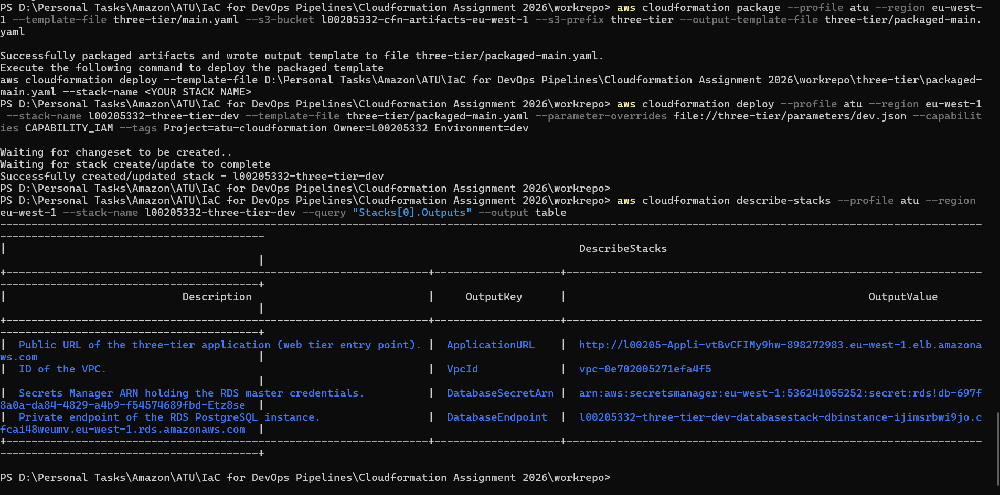

| Output | Value | Tier |
|--------|-------|------|
| ApplicationURL | `http://l00205-Appli-vtBvCFIMy9hw-898272983.eu-west-1.elb.amazonaws.com` | Web: the public entry point |
| VpcId | `vpc-0e702005271efa4f5` | Network |
| DatabaseEndpoint | `l00205332-three-tier-dev-databasestack-dbinstance-ijimsrbwi9jo.cfcai48weumv.eu-west-1.rds.amazonaws.com` | Database: private, not internet-routable |
| DatabaseSecretArn | Secrets Manager secret created and managed by RDS | Database credentials, never in the template |

> These resources are destroyed after testing (see [section 10](#10-clean-up)), so the URL no
> longer works.

#### Functional checks

All five checks passed.

| # | Check | Command / action | Expected | Result |
|---|-------|------------------|----------|--------|
| 1 | Web tier reaches the app tier | Open the ApplicationURL in a browser | Page with L-number, name, instance ID and AZ | ✅ Page served by `i-03d9482278b6a4dc0` in `eu-west-1b`, header `L00205332 – Mohamed Hanafi Sayed Khalifa Ismail` |
| 2 | Load balancing across AZs | Repeated requests | Instance and AZ alternate | ✅ Consecutive requests answered by `i-03d9482278b6a4dc0` (`eu-west-1b`) and `i-08eea7619f5b7a1a7` (`eu-west-1a`) |
| 3 | App tier reaches the DB tier | `curl.exe -s <ApplicationURL>/api/visits` (repeated) | `visits` count increases | ✅ `1` (browser), then `2`, then `3`. Every instance writes to and reads from the same PostgreSQL database. |
| 4 | Health check endpoint | `curl.exe -s <ApplicationURL>/api/health` | `{"status": "ok", ...}` | ✅ `{"status": "ok", "instance": "i-03d9482278b6a4dc0"}` |
| 5 | Database is private | `nslookup <DatabaseEndpoint>` | Private IP | ✅ Resolves to `10.0.5.73`, in the isolated DB subnet `db-b` (`10.0.5.0/24`). The name is public DNS, but the address cannot be routed from the internet. |

API responses:

```text
GET /api/visits  ->  {"visits": 2, "served_by": "i-03d9482278b6a4dc0", "availability_zone": "eu-west-1b"}
GET /api/visits  ->  {"visits": 3, "served_by": "i-08eea7619f5b7a1a7", "availability_zone": "eu-west-1a"}
GET /api/health  ->  {"status": "ok", "instance": "i-03d9482278b6a4dc0"}
nslookup <DatabaseEndpoint>  ->  Address: 10.0.5.73
```

#### The live application

The page is produced by the application tier, which runs on EC2 in a private subnet and is
reached only through the load balancer. The visit count comes from the database tier. It shows
`1` here because this was the first request ever recorded in the `visits` table.

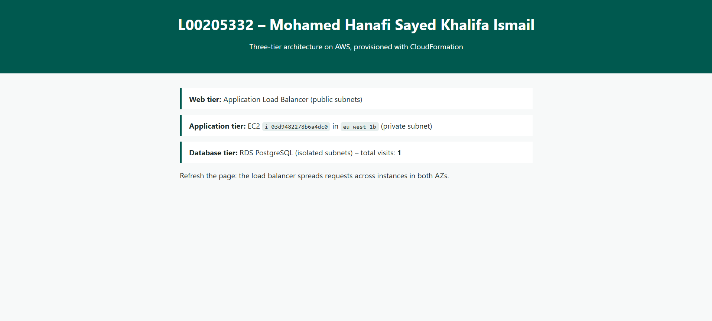

#### Application tier: EC2 instances

The Auto Scaling group launched two `t4g.micro` (Graviton/arm64) instances, one in each
Availability Zone (`eu-west-1a` and `eu-west-1b`). Both pass 3/3 status checks. Neither has a
public IPv4 address, public DNS name or Elastic IP: they sit in private subnets with no internet
route.

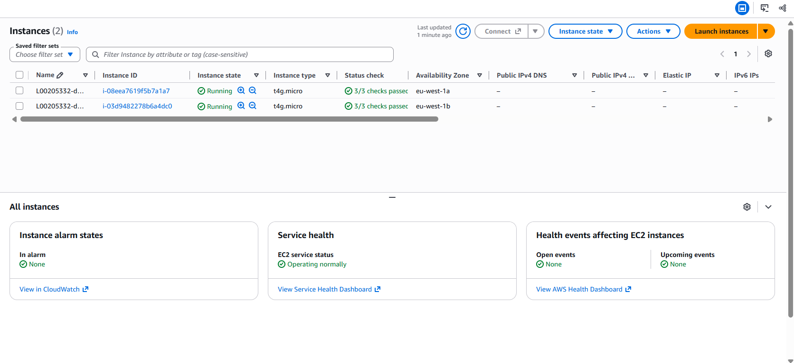

#### Web tier: Application Load Balancer

The ALB is `Active`, `internet-facing`, and spans 2 Availability Zones in the project VPC
(`vpc-0e702005271efa4f5`). It is the only resource with a public entry point.

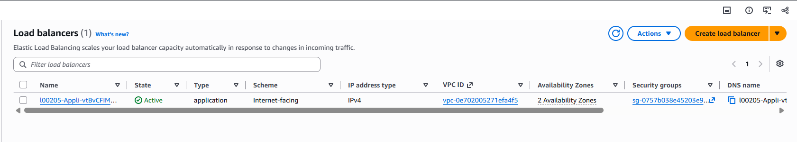

#### Application tier: Auto Scaling group

The group is `At desired capacity` with 2 instances (min 2, max 4), and both are healthy against
the ALB health check (`/api/health`). The instances are created from the launch template
defined in the compute module.

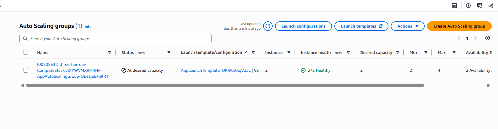

#### Database tier: RDS PostgreSQL

The `db.t4g.micro` PostgreSQL instance is `Available`. **Internet access gateway: Disabled**
confirms it is not publicly accessible. The master credentials are held in AWS Secrets Manager
(**Master credentials ARN**), because `ManageMasterUserPassword: true` means RDS generated the
password. It never appears in the template, the parameters or the console.

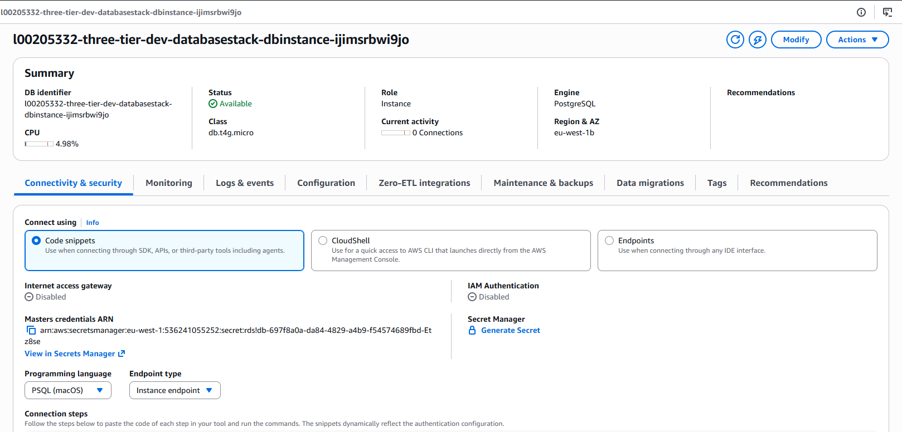

### 6.4 Testing the next-level improvements

Redeployed on 2026-10-31 from `main` after PR #13 (app releases, Multi-AZ RDS, monitoring).
The stack reached `CREATE_COMPLETE`. A second `deploy` with only `AlertEmail` changed updated
just the SNS email subscription in the monitoring module, which shows a targeted in-place stack
update.

#### Summary

| # | Improvement | Check | Result |
|---|-------------|-------|--------|
| 1 | App out of user data | `/api/visits` x2 and `/api/health` | ✅ `visits` 1 then 2, served by `i-0a230b67286f75328` (`eu-west-1b`) and `i-002bd620871c2866b` (`eu-west-1a`); health `ok`. Both instances installed release `1.0.0` from S3. |
| 2 | Multi-AZ RDS | Console: Configuration tab | ✅ `Multi-AZ: Yes`, primary `eu-west-1a`, secondary zone `eu-west-1b` |
| 2 | Multi-AZ RDS | Forced failover (`reboot-db-instance --force-failover`) | ✅ Failover started 19:33:57, completed 19:34:35 (**38 s**). The app returned `503` only until 19:34:23 and `200` from 19:34:29 onward, with no restart or redeploy. |
| 2 | Multi-AZ RDS | Endpoint after failover | ✅ The same DNS name now resolves to `10.0.5.84`, in DB subnet `10.0.5.0/24` (`eu-west-1b`): the former standby is now the primary |
| 3 | Monitoring | CloudWatch alarms | ✅ All 9 alarms created, all in `OK` |
| 3 | Monitoring | SNS | ✅ Topic `L00205332-dev-alerts` with an email subscription |
| 3 | Monitoring | RDS events | ✅ Failover events recorded: *failover started*, *instance restarted*, *failover completed* |
| 3 | VPC Flow Logs | `aws logs describe-log-streams` | ✅ One stream per network interface (`eni-...-all`) |
| 3 | ALB access logs | `aws s3 ls .../alb/` | ✅ `ELBAccessLogTestFile` (ELB's write test against the bucket policy), then one `.log.gz` file every 5 minutes |

#### Infrastructure: Multi-AZ database, instances and alert topic

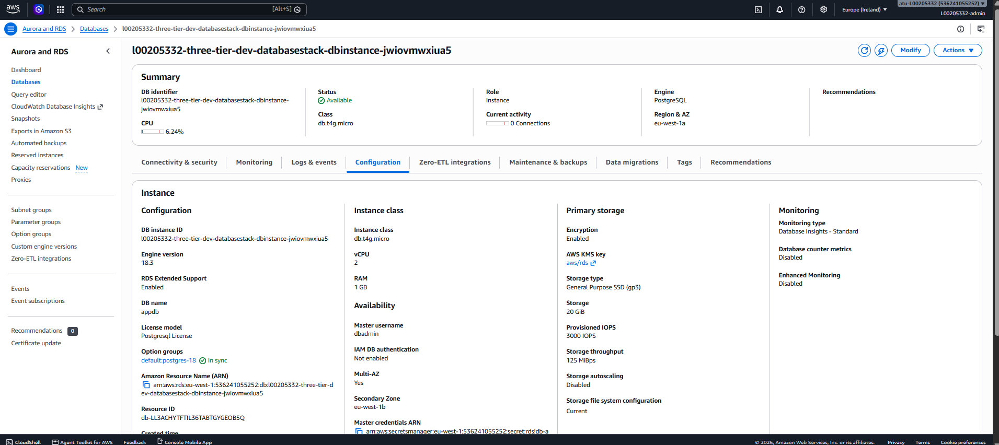

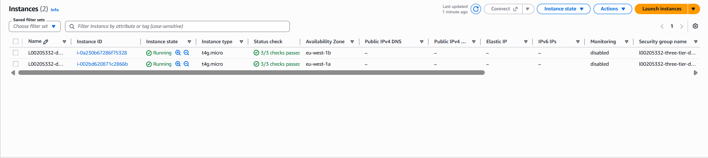

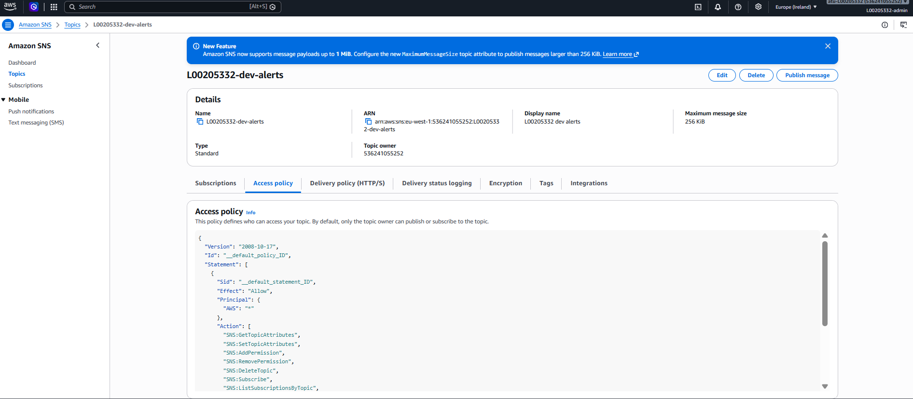

#### Application, failover and flow logs (terminal)

The terminal output below shows:
- both instances serving the app from release `1.0.0`;
- the AZs before the failover;
- the failover command;
- the availability probe (`503 503`, then only `200`s);
- the flow-log streams.

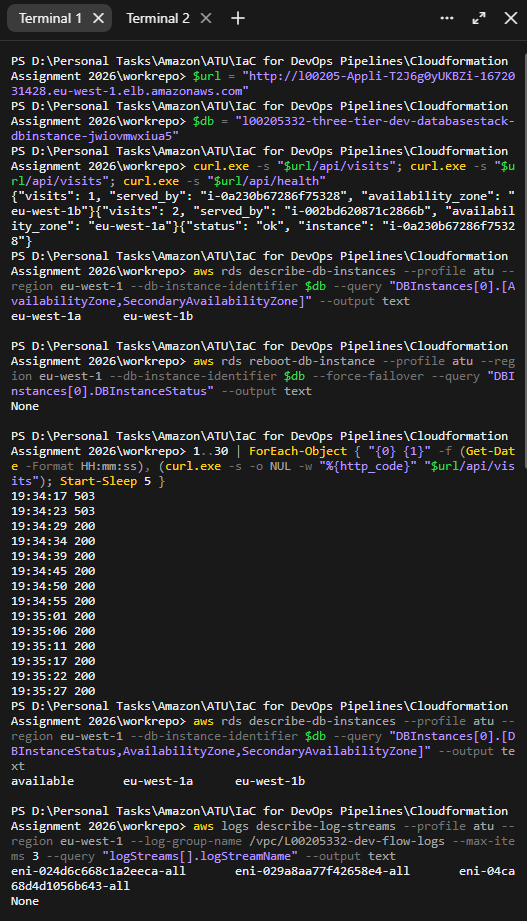

Failover timeline, from the RDS events and the probe:

```text
19:33:57  Multi-AZ instance failover started
19:34:13  DB instance restarted
19:34:17  app /api/visits -> 503   (database unavailable; ALB health checks unaffected)
19:34:23  app /api/visits -> 503
19:34:29  app /api/visits -> 200   (recovered: new connection to the promoted standby)
19:34:35  Multi-AZ instance failover completed
```

> **Observation:** straight after the failover, `describe-db-instances` still reported
> `AvailabilityZone: eu-west-1a`. DNS gave the definitive answer: the endpoint resolved to
> `10.0.5.84`, which is in the `eu-west-1b` DB subnet. The API's AZ field can lag behind the
> actual failover, so checking the endpoint's IP against the subnet map is a reliable,
> independent way to verify which AZ is now primary.

#### ALB access logs

`ELBAccessLogTestFile` appears first. It is the file Elastic Load Balancing writes to verify the
bucket policy when logging is enabled, which confirms that the regional log-delivery account
mapping is correct. After that, one compressed log file arrives per load balancer node every
5 minutes.

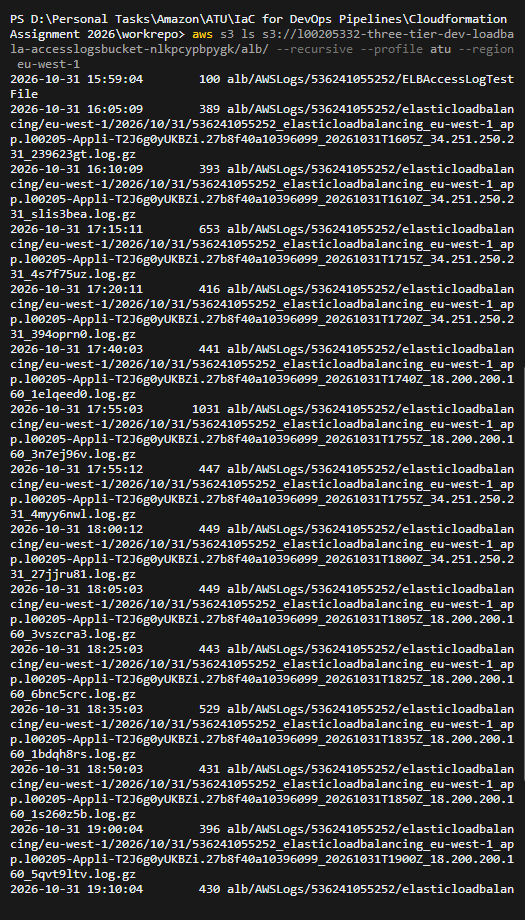

#### Database alarms and RDS events

The RDS console lists the four database alarms (all `OK`) and the event history. The history
includes the Multi-AZ conversion during creation ("Applying modification to convert to a
Multi-AZ DB Instance", 15:59 to 16:06) and the forced failover at 19:33 to 19:34.

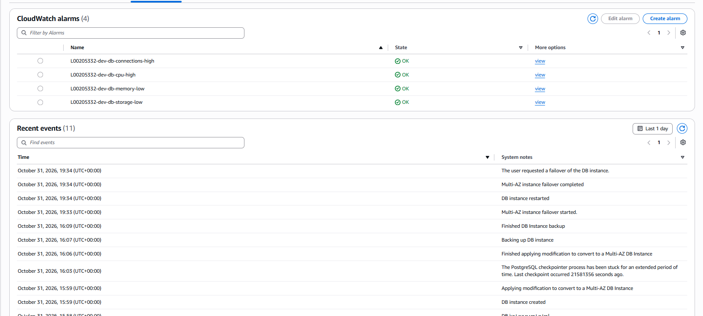

## 7. Part B: Best practices and "ilities"

### 7.1 Security

**Already in place:**

- **Encryption at rest:** EC2 volumes (`Encrypted: true` in the launch template), RDS storage,
  S3 buckets (SSE-S3) and Secrets Manager.
- **Encryption in transit:** the app connects to the database over TLS (`sslmode=require`).
  The static site is HTTPS-only through CloudFront, and the S3 bucket policies deny any
  non-TLS request.
- **Network isolation:** the app and database tiers run in private subnets with no internet
  route. Security groups only allow traffic from the tier in front (Internet → ALB → app →
  DB). The S3 website bucket is private and readable only through CloudFront OAC.
- **Secrets and identity:**
  - The database password is generated by RDS and kept in Secrets Manager.
  - IAM roles are least-privilege.
  - Instances require IMDSv2.
  - The root user has MFA, and day-to-day work uses a separate admin user.

**What I would still need to do:**

- Install an SSL/TLS certificate (ACM, with a registered domain) on the load balancer, so the
  public interface of the three-tier application uses HTTPS instead of HTTP.
- Encrypt the remaining hop between tiers, ALB → app instances, which is HTTP inside the VPC
  today (for example HTTPS to the targets, or TLS terminated on the instances).

### 7.2 Scalability

**Already in place:** an Auto Scaling group (2 to 4 instances, target-tracking at 50% CPU)
behind an Application Load Balancer across two Availability Zones, CloudFront for the static
site, and a Multi-AZ database.

**What I would still need to do:** adopt Aurora for better database scalability (read
replicas and storage that grows automatically). The Multi-AZ standby protects availability, but
it cannot serve reads.

### 7.3 Performance

**Already in place:** CloudFront edge caching with compression and HTTP/2 and HTTP/3 for the
static site, Graviton (arm64) instances, and a CloudWatch alarm on slow responses.

**What I would still need to do:** benchmark the resources against the CloudWatch metrics I now
collect (response time, CPU, database connections and memory), to see whether larger instance
sizes or more instances would actually help.

### 7.4 Cost

**Already in place:**

- No NAT Gateway: VPC endpoints are used instead.
- Free-tier-sized instances and the cheapest CloudFront price class.
- Log and old-version expiry, and 14-day log retention.
- A budget alarm on the account.
- Every stack is destroyed after each test session.

**What I would still need to do:** after going to production, review the cost recommendations
more regularly with AWS Trusted Advisor, AWS Compute Optimizer (instance right-sizing) and Cost
Explorer.

### 7.5 Code quality and tooling

I am mainly infrastructure-focused, and code tooling is an area I want to learn more about. In
this project the code quality is enforced by:

- `cfn-lint` on every template (locally and in CI).
- `cfn-nag` security scanning, with every intentional exception suppressed in the template
  with a written reason.
- `ruff` lint and formatting checks on the application code.
- Commented, parameterised templates (no hard-coded names or environment values), split into
  reusable nested-stack modules.

#### Continuous integration

[`.github/workflows/cfn-validate.yml`](.github/workflows/cfn-validate.yml) runs on every pull
request to `main`, on every push to `main`, and on demand:

| Job | Tool | What it checks | Blocks the PR on |
|-----|------|----------------|------------------|
| `cfn-lint` | [cfn-lint](https://github.com/aws-cloudformation/cfn-lint) 1.58.0 | Template syntax, resource properties and values for `eu-west-1`, best-practice rules | Errors |
| `app lint (ruff)` | [ruff](https://docs.astral.sh/ruff/) 0.6.9 | Lint and formatting of `three-tier/app/`, targeting Python 3.9 (Amazon Linux 2023) | Lint or format errors |
| `cfn-nag (advisory)` | [cfn-nag](https://github.com/stelligent/cfn_nag) | Security anti-patterns: open security groups, missing encryption, broad IAM, public resources | Never (report-only) |

cfn-lint warnings are printed but do not block a merge. When a finding is an intentional design
decision, it is suppressed in the template with a written reason, so every exception is
documented next to the code it applies to. For example, RDS deletion protection (`F80`) is off
because the lab stack must be destroyed after every session.

**How the cfn-nag policy evolved (PRs #10 to #12):**

1. **#10** added the workflow with cfn-nag set to block on FAILURES. Its first run found a real
   issue, `F24`: the RDS master username was a plain parameter. The PR was merged before the
   check passed, so `main` went red.
2. **#11** fixed `F24` properly, with no suppression: the database module's `DBUsername`
   parameter is now `NoEcho`, and `main` went green again.
3. **#12** made cfn-nag **advisory** (`continue-on-error: true`). Its findings stay visible in
   every run, but they no longer block merges.

The remaining cfn-nag warnings are known and accepted for this lab:

| Rule | Resource | Finding | Status |
|------|----------|---------|--------|
| W2, W9 | ALB security group | Ingress open to `0.0.0.0/0` | Intentional: a public load balancer must accept all clients |
| W5 | App security group | Egress `0.0.0.0/0` on port 443 | Low risk: app subnets have no internet route, only VPC endpoints |
| W56 | HTTP listener | Not HTTPS | Suppressed with a reason: requires an ACM certificate and a domain |
| W52 | ALB | No access logging | **Resolved**: ALB access logs to S3 (monitoring improvement) |
| W60 | VPC | No flow logs | **Resolved**: VPC Flow Logs to CloudWatch Logs (monitoring improvement) |
| W47 | SNS topic | No KMS encryption | Suppressed with a reason: CloudWatch alarms cannot publish to a topic encrypted with the AWS-managed key |

## 8. Taking it to the next level

The LLM produced the baseline: one template for the static site and one for the three-tier
architecture. On top of that baseline, I extended and changed the design as follows:

| Improvement | What changed | PR | Details |
|-------------|--------------|----|---------|
| Modular structure | Split each single template into a root stack plus reusable nested-stack modules and per-environment parameter files. I added a separate `loadbalancer` module for the web tier. | #7 | [4.1](#41-how-the-projects-are-deployed-nested-stacks) |
| CI pipeline | GitHub Actions running cfn-lint, ruff and cfn-nag on every pull request. It caught a real issue (F24), which was fixed in #11. | #10 to #12 | [7.5](#75-code-quality-and-tooling) |
| App separated from instance deployment | The Python app now lives in `three-tier/app/` and is delivered as a versioned S3 release, with rolling instance updates. | #13 | [6.1](#application-releases) |
| Multi-AZ RDS | Synchronous standby with automatic failover, chosen over Aurora for cost. Verified with a forced failover: 38 s, and the app recovered by itself. | #13 | [6.4](#64-testing-the-next-level-improvements) |
| Monitoring and logs | 9 CloudWatch alarms plus RDS events sent to SNS email, ALB access logs and VPC Flow Logs. | #13 | [6.1](#monitoring-alerting-and-logging) |
| Clean-up fix | A log group survived stack deletion; fixed with least-privilege logging. | #15 | [10.2](#102-finding-from-clean-up-testing-a-log-group-that-survived-stack-deletion) |

## 9. Workflow: branches and pull requests

**Branching strategy**

- `main` holds only reviewed, merged code, and every deployment to AWS runs from `main`.
- All work happens on a short-lived branch, merged through a pull request. Branch names say
  what kind of change it is: `chore/`, `feature/`, `refactor/`, `docs/`, `ci/`, `fix/`.
- Commit messages follow [Conventional Commits](https://www.conventionalcommits.org/), for
  example `feat(db): ...`, `fix: ...`, `docs: ...`.
- One logical change per commit. Related features may share a branch (PR #13 has four
  commits), so they can be tested together in a single paid AWS session.
- From PR #10 onwards, every pull request is checked by the CI workflow (cfn-lint, ruff and
  cfn-nag).
- Deployment evidence is committed on separate `docs/` branches after each AWS test session.
- I ran every commit, push and merge myself.

**Pull requests**

| PR | Branch | Purpose |
|----|--------|---------|
| #1, #2 | `L00205332-patch-1`, `L00205332-patch-2` | Repository set-up: Code of Conduct (edited in the GitHub web editor, which creates `patch-N` branches) |
| #3 | `chore/project-setup` | Project scaffolding: `.gitignore`, `.gitattributes`, cfn-lint config, README skeleton, `PROMPTS.md` |
| #4 | `chore/project-setup` | Prompt-log update pushed after #3 was merged |
| #5 | `feature/static-site` | Part A(a): S3 + CloudFront static website (single template) |
| #6 | `feature/three-tier` | Part A(b): VPC, ALB, Auto Scaling and RDS (single template) |
| #7 | `refactor/modular-nested-stacks` | Split into two projects with nested-stack modules and parameter files |
| #8 | `docs/static-site-evidence` | Static site deployment evidence and test results |
| #9 | `docs/three-tier-evidence` | Three-tier deployment evidence and test results |
| #10 | `feature/ci-validation` | CI workflow: cfn-lint + cfn-nag (merged while cfn-nag was failing; see 7.5) |
| #11 | `feature/ci-validation` | Fix for cfn-nag F24 (RDS username `NoEcho`), which turned `main` green |
| #12 | `ci/cfn-nag-advisory` | cfn-nag made advisory (report-only) |
| #13 | `feature/next-level` | Next level: app releases from S3, Multi-AZ RDS, monitoring and logs (4 commits) |
| #14 | `docs/next-level-evidence` | Next-level deployment evidence (failover test, logs, alarms) |
| #15 | `fix/lambda-log-groups` | Fix for the Lambda log group that survived stack deletion |

**Git commands used, per PR**

All commands were run in PowerShell from the `workrepo` folder. `gh` is the GitHub CLI.

<details>
<summary>PR #3: project set-up (first clone)</summary>

```powershell
git clone https://github.com/L00205332/workrepo.git
cd workrepo
git switch -c chore/project-setup
git add .
git commit -m "chore: add project scaffolding, lint config and prompt log"
git push -u origin chore/project-setup
# PR opened from the link printed by git push, then merged on GitHub
```

</details>

<details>
<summary>PR #4: prompt-log update on the same branch</summary>

```powershell
git add PROMPTS.md
git commit -m "docs: log P9-P10 in PROMPTS.md"
git push
gh pr create --base main --head chore/project-setup --title "docs: log P9-P10 in PROMPTS.md"
# merged on GitHub
git switch main
git pull
```

</details>

<details>
<summary>PR #5 and PR #6: Part A(a) and Part A(b) templates</summary>

```powershell
git switch -c feature/static-site
git add templates/static-site.yaml README.md PROMPTS.md
git commit -m "feat: static website on S3 + CloudFront (Part A(a))"
git push -u origin feature/static-site
# PR #5 merged on GitHub
git switch main
git pull

git switch -c feature/three-tier
git add templates/three-tier.yaml
git commit -m "feat: three-tier VPC, ALB, ASG and RDS (Part A(b))"
git push -u origin feature/three-tier
# PR #6 merged on GitHub
git switch main
git pull
```

</details>

<details>
<summary>PR #7: modular refactor (nested stacks)</summary>

```powershell
git switch -c refactor/modular-nested-stacks
git add -A          # stages the new folders and the deletion of templates/
git status
git commit -m "refactor: split into static-site and three-tier projects with nested-stack modules"
git push -u origin refactor/modular-nested-stacks
# merged on GitHub
```

</details>

<details>
<summary>PR #8 and PR #9: deployment evidence</summary>

```powershell
git switch -c docs/static-site-evidence origin/main
git add -A
git commit -m "docs: add static site deployment evidence and test results"
git push -u origin docs/static-site-evidence
# PR #8 merged on GitHub
git switch main
git pull

git switch -c docs/three-tier-evidence
git add -A
git commit -m "docs: add three-tier deployment evidence and test results"
git push -u origin docs/three-tier-evidence
# PR #9 merged on GitHub
git switch main
git pull
```

</details>

<details>
<summary>PR #10, PR #11 and PR #12: CI pipeline</summary>

```powershell
git switch -c feature/ci-validation
git add -A
git commit -m "ci: add cfn-lint and cfn-nag validation workflow"
git push -u origin feature/ci-validation
gh pr create --base main --title "ci: CloudFormation validation (cfn-lint + cfn-nag)" --body "..."
# PR #10 merged (cfn-nag failed with F24)

git add three-tier/modules/database.yaml
git commit -m "fix(db): mask master username with NoEcho (cfn-nag F24)"
git push
gh pr create --base main --head feature/ci-validation --title "fix(db): mask master username with NoEcho (cfn-nag F24)" --body "..."
# PR #11 merged after both checks passed
git switch main
git pull

git switch -c ci/cfn-nag-advisory
git add .github/workflows/cfn-validate.yml
git commit -m "ci: make cfn-nag report-only (advisory)"
git push -u origin ci/cfn-nag-advisory
gh pr create --base main --title "ci: make cfn-nag advisory" --body "..."
# PR #12 merged after the checks passed
git switch main
git pull
```

</details>

<details>
<summary>PR #13: next-level improvements (one branch, one commit per feature)</summary>

```powershell
git switch -c feature/next-level

git add -A
git commit -m "refactor(app): move application out of user data into three-tier/app with versioned S3 releases"
git add -A
git commit -m "docs: document application releases, CI jobs and cfn-nag policy"
git add -A
git commit -m "feat(db): enable Multi-AZ RDS by default with maintenance windows"
git add -A
git commit -m "feat(monitoring): add CloudWatch alarms, SNS alerts, RDS events, ALB access logs and VPC flow logs"

git push -u origin feature/next-level
gh pr create --base main --title "feat: next-level improvements (app releases, Multi-AZ RDS, monitoring)" --body "..."
# merged on GitHub after all three CI checks passed
git switch main
git pull
```

</details>

<details>
<summary>PR #14: next-level evidence</summary>

```powershell
git switch -c docs/next-level-evidence
git add -A
git commit -m "docs: add next-level deployment evidence (app releases, Multi-AZ failover, monitoring)"
git push -u origin docs/next-level-evidence
gh pr create --base main --title "docs: next-level deployment evidence" --body "..."
# merged on GitHub
```

</details>

<details>
<summary>PR #15: Lambda log-group fix</summary>

```powershell
git fetch
git switch -c fix/lambda-log-groups origin/main
git add -A
git commit -m "fix: pin custom-resource Lambdas to managed log groups and drop logs:CreateLogGroup"
git push -u origin fix/lambda-log-groups
gh pr create --base main --title "fix: Lambda log groups surviving stack deletion" --body "..."
# merged on GitHub after the checks passed
```

</details>

**Lesson learned:** PR #10 was merged while its cfn-nag check was red, which broke `main` until
PR #11 fixed it. A follow-up push to an already-merged branch also does not trigger CI until a
new PR is opened. Requiring status checks in a branch protection rule on `main` would prevent
both problems.

## 10. Clean-up

```bash
# Deleting a root stack also deletes all of its nested (module) stacks.

# Static site: the content deployer Lambda empties the bucket automatically on delete.
aws cloudformation delete-stack --profile atu --region eu-west-1 --stack-name l00205332-static-site-dev
aws cloudformation wait stack-delete-complete --profile atu --region eu-west-1 --stack-name l00205332-static-site-dev

# Three-tier: the ALB access-log bucket is emptied automatically, and the flow-log group
# is deleted with the stack. RDS keeps a final snapshot (DeletionPolicy: Snapshot);
# delete it afterwards.
aws cloudformation delete-stack --profile atu --region eu-west-1 --stack-name l00205332-three-tier-dev
aws cloudformation wait stack-delete-complete --profile atu --region eu-west-1 --stack-name l00205332-three-tier-dev
aws rds describe-db-snapshots --profile atu --region eu-west-1 --snapshot-type manual \
  --query "DBSnapshots[].DBSnapshotIdentifier" --output text
aws rds delete-db-snapshot --profile atu --region eu-west-1 --db-snapshot-identifier <snapshot-id>

# At the end of the module (not every session): remove the artifacts bucket and its contents
aws s3 rb s3://l00205332-cfn-artifacts-eu-west-1 --force --profile atu --region eu-west-1
```

### 10.1 Confirm nothing is left running

Run these after every session. Each command should return an empty result.

```bash
# No project stacks left (deleted stacks are not listed)
aws cloudformation list-stacks --profile atu --region eu-west-1 \
  --stack-status-filter CREATE_COMPLETE UPDATE_COMPLETE ROLLBACK_COMPLETE DELETE_FAILED \
  --query "StackSummaries[?starts_with(StackName,'l00205332')].StackName" --output text

# No running EC2 instances, RDS databases, load balancers or leftover snapshots
aws ec2 describe-instances --profile atu --region eu-west-1 \
  --filters Name=instance-state-name,Values=pending,running,stopping,stopped \
  --query "Reservations[].Instances[].InstanceId" --output text
aws rds describe-db-instances --profile atu --region eu-west-1 --query "DBInstances[].DBInstanceIdentifier" --output text
aws elbv2 describe-load-balancers --profile atu --region eu-west-1 --query "LoadBalancers[].LoadBalancerName" --output text
aws rds describe-db-snapshots --profile atu --region eu-west-1 --snapshot-type manual --query "DBSnapshots[].DBSnapshotIdentifier" --output text

# No log groups left behind by the project's Lambda functions or VPC flow logs
aws logs describe-log-groups --profile atu --region eu-west-1 --log-group-name-prefix /aws/lambda/l00205332 --query "logGroups[].logGroupName" --output text
aws logs describe-log-groups --profile atu --region eu-west-1 --log-group-name-prefix /vpc/L00205332 --query "logGroups[].logGroupName" --output text
```

If a stack ends in `DELETE_FAILED`, open its **Events** tab in the CloudFormation console, fix the
blocking resource (for example, empty a bucket by hand), then delete the stack again.

### 10.2 Finding from clean-up testing: a log group that survived stack deletion

After the next-level test session, every resource was gone except one: a CloudWatch log group
for the static site's content-deployer Lambda, re-created with **no retention limit**.

**Cause: a race on deletion.** On `delete-stack`, the custom resource invokes the Lambda one
last time, and CloudFormation then deletes the log group. The function's final log lines arrive
a moment later. The functions used the AWS managed policy `AWSLambdaBasicExecutionRole`, which
grants `logs:CreateLogGroup` on `*`, so Lambda silently re-created the group outside
CloudFormation's control. The three-tier bucket-emptier Lambda had the same weakness.

**Fix:** both custom-resource functions (`static-site/modules/content.yaml` and
`three-tier/modules/loadbalancer.yaml`) were changed in three ways:

1. They log to an **explicitly named, template-managed log group** through
   `LoggingConfig.LogGroup`. The name is based on the stack name, not the function name, so the
   role can reference it without a circular dependency.
2. `AWSLambdaBasicExecutionRole` was replaced with an **inline policy** that allows only
   `logs:CreateLogStream` and `logs:PutLogEvents` on that one log group.
3. Without `logs:CreateLogGroup`, a late log write fails harmlessly instead of re-creating the
   group.

This is also a least-privilege improvement: each function can now write only to its own log
group, instead of creating and writing to any log group in the account. The 10.1 checks now
include the log groups.

**Verification (2026-10-31):**

1. Deleted the leftover log group by hand.
2. Deployed the fixed static site and deleted it again. The nested stacks were removed in
   dependency order: content 20:19:04, cdn 20:19:38, storage 20:22:40.
3. Ran the log-group check (`describe-log-groups --log-group-name-prefix /aws/lambda/l00205332`)
   straight after the delete, and again a few minutes later. It returned **nothing** both
   times: no log group re-appeared.

## 11. References

- **LLM:** Claude Code (Claude Opus 5.5). Every prompt is declared in [PROMPTS.md](PROMPTS.md).
  I did not use any third-party templates or tutorials.
- **Documentation referenced:**
  - AWS Lambda Developer Guide, *Infrastructure as code (IaC)* (quoted in the assignment brief):
    https://docs.aws.amazon.com/lambda/latest/dg/foundation-iac.html
  - Elastic Load Balancing, *Enable access logs for your Application Load Balancer* (log-delivery
    account per Region): https://docs.aws.amazon.com/elasticloadbalancing/latest/application/enable-access-logging.html
  - cfn-lint: https://github.com/aws-cloudformation/cfn-lint
  - cfn-nag: https://github.com/stelligent/cfn_nag
  - ruff: https://docs.astral.sh/ruff/
  - Conventional Commits: https://www.conventionalcommits.org/
